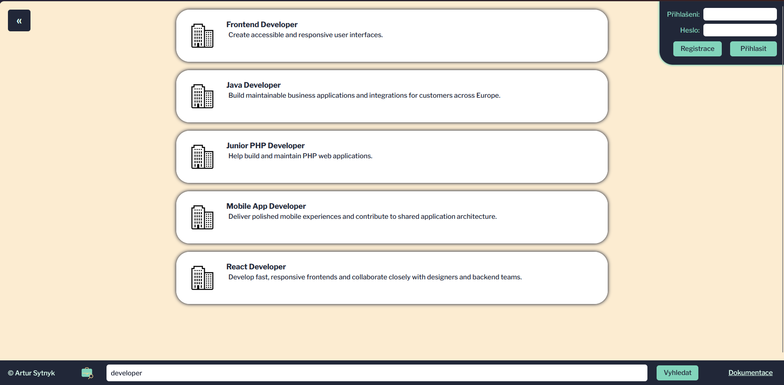
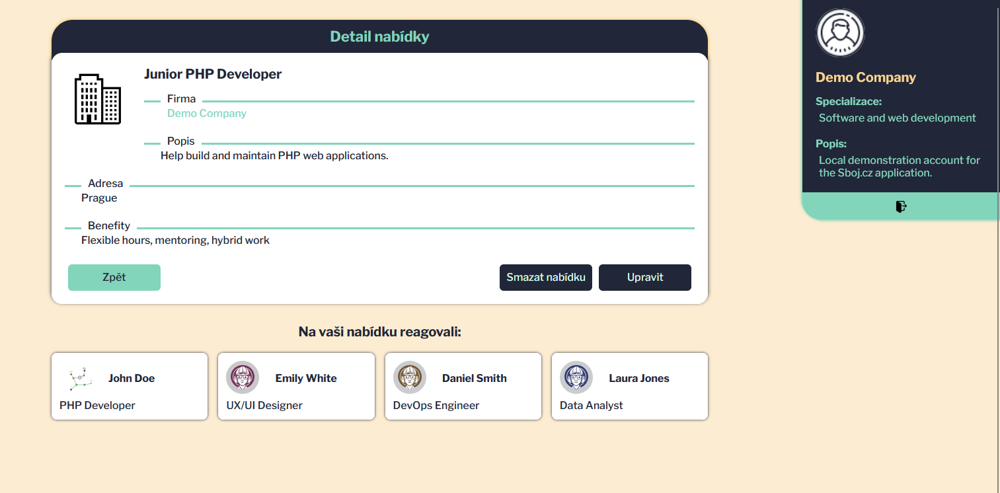
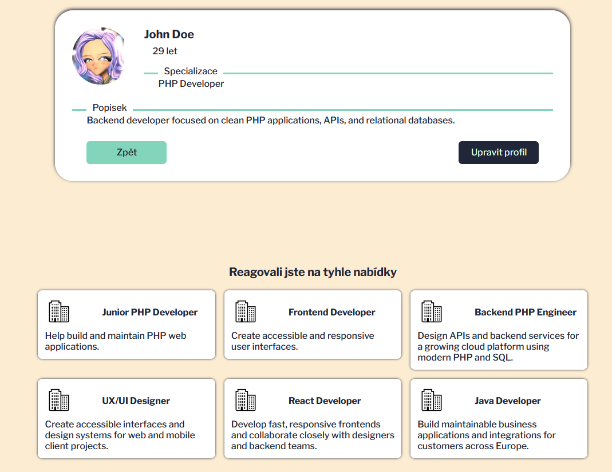
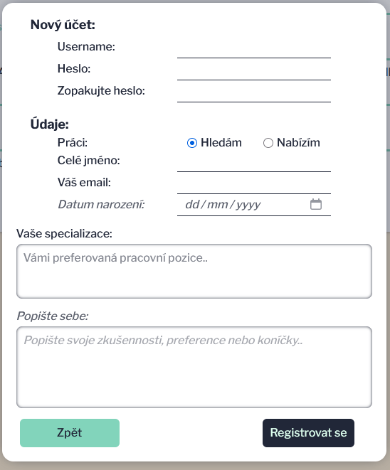

# Sboj.cz

A simple PHP/MySQL job portal web application for browsing and managing job offers, with user registration, login, profile pages, and job-application workflows.

> [!NOTE]
> This repository preserves a student project in approximately the state in which it was created. It is intended to demonstrate practical PHP and full-stack fundamentals, not to represent a production-ready recruitment platform.

## About the project

- Built a self-contained PHP job board prototype with user registration and login.
- Created profile management and image upload support for users and job postings.
- Implemented job listing, search, pagination, and application flows.
- Added session-based authentication and access control for posting owners.
- Included a responsive HTML/CSS layout with lightweight JavaScript validation.

## Features

- User registration and login with session management
- Job listing and search with pagination
- Job detail view with apply, edit, and delete actions
- User profile editing and avatar upload
- Role-based flows for job seekers and posting owners
- Server-rendered PHP templates with shared database helper functions

## Screenshots

### Job search and listings

### Employer view and applicants

### Applicant profile and registration

  
  

## Technologies

- PHP
- SQLite or MySQL / PDO
- HTML
- CSS
- JavaScript

## Running locally

1. Ensure PHP has PDO for SQLite and the GD extension enabled.
2. Copy `.env.example` to `.env`. The default configuration uses a local `database.sqlite` file.
3. Start the PHP development server with `php -S localhost:8000`.
4. Open `http://localhost:8000` in a browser.

The SQLite database and its tables are created automatically on first request using `database/schema.sql` and `database/portfolio_seed.sql`. The portfolio dataset contains four employers, four applicants, and fifteen job postings. All demo accounts use the password `Demo123`; useful usernames include `demo-company`, `northstar-labs`, `greenline-studio`, `morava-digital`, and `john-doe`. Delete `database.sqlite` to rebuild this initial local data.

To use MySQL instead, set `DB_DRIVER=mysql` and provide the existing `DB_HOST`, `DB_NAME`, `DB_USER`, and `DB_PASS` values.

## Project context

Created as a standalone PHP/MySQL web application prototype for browsing and managing job offers. The project reflects my student-stage understanding of PHP and focuses on practical full-stack learning: server-rendered pages, PDO database access, authentication sessions, CRUD workflows, relational data, file uploads, search, and pagination.

The original architecture and implementation style are intentionally visible rather than being rewritten as a modern production system. This makes the repository a record of what I built and understood at that point in my learning.
